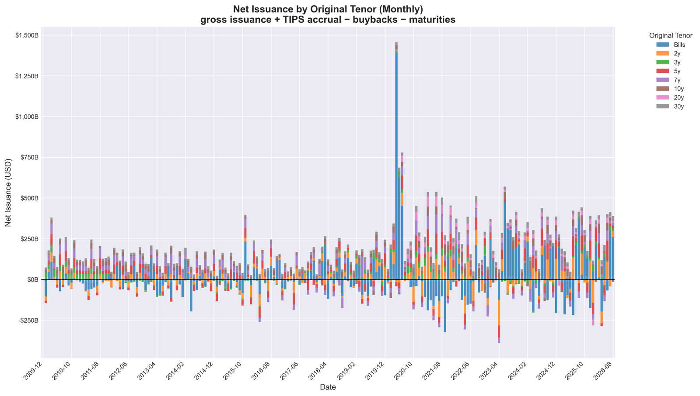
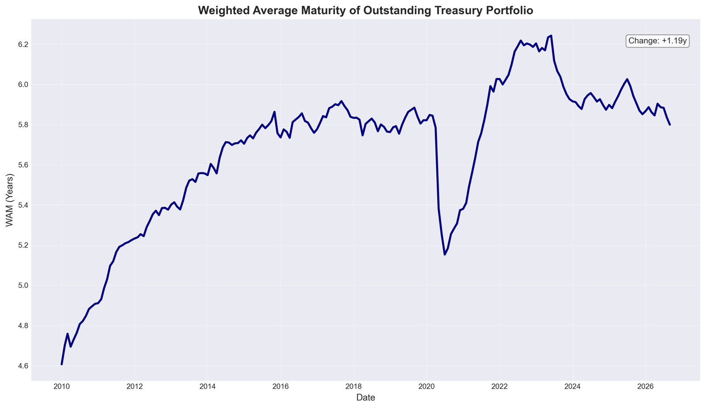
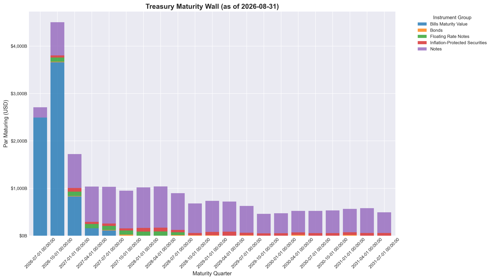
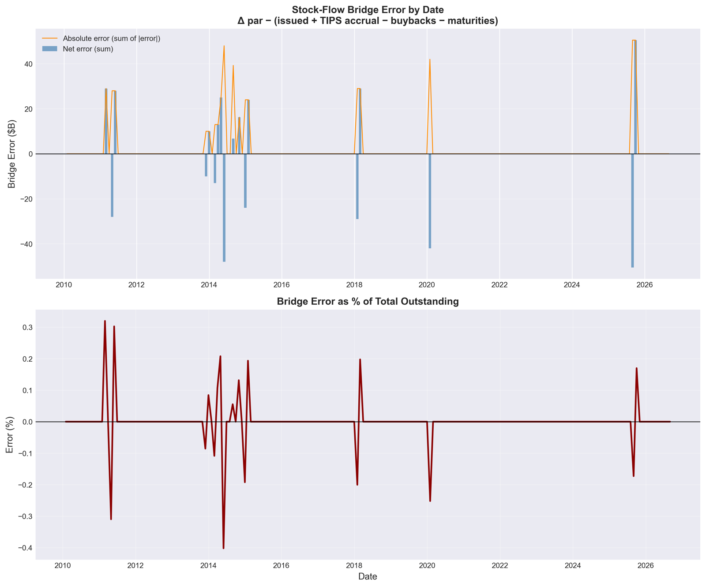

# Treasury Issuance Analysis

Python toolkit for analyzing U.S. Treasury marketable debt: portfolio composition, maturity profile, gross and net issuance, and rollover needs relative to the Treasury General Account (TGA). Data comes from the Treasury Fiscal Data API.

The pipeline builds a CUSIP-by-month panel from the Monthly Statement of the Public Debt (MSPD), reconciles it stock-to-flow, and produces static charts plus a Tkinter dashboard.



## Installation

Requires Python 3.9+.

```bash
python -m venv .venv
source .venv/bin/activate        # Windows: .venv\Scripts\activate
pip install -r requirements.txt
```

The dashboard uses Tkinter, which ships with most Python installers. It is not installable from pip; on some Linux distributions install it with the system package manager (e.g. `sudo apt install python3-tk`).

## Usage

```bash
python main.py --all              # pipeline + charts + summary (default)
python main.py --all --refresh    # same, ignoring the 24h API cache
python main.py --pipeline         # fetch and build the panel only
python main.py --charts           # charts from the saved panel
python main.py --tga              # TGA charts (fetches DTS data)
python main.py --summary          # print latest portfolio metrics
python main.py --dashboard        # interactive dashboard
```

Outputs are written next to the code: `data/` (panel as Parquet and CSV, monthly reconciliation CSV), `charts/` (PNGs) and `cache/` (raw API responses, reused for 24 hours). All three are generated and gitignored.

### Dashboard

`python main.py --dashboard` opens a Tkinter window with four tabs (Overview, Composition, Issuance, Maturity) and an "As of" date selector. It reads the saved panel; **Reload from disk** picks up a newer panel after you rerun the pipeline. It does not call the API itself.

### Programmatic use

```python
from data_ingest import run_full_pipeline, load_processed_data
from analytics import PortfolioAnalytics
from charts import ChartGenerator

df = load_processed_data()            # or run_full_pipeline()
analytics = PortfolioAnalytics(df)
print(analytics.compute_portfolio_metrics().weighted_avg_maturity)
print(analytics.compute_reconciliation().tail())

ChartGenerator(df).chart_maturity_wall()
```

## Methodology

**Source.** MSPD Table 3, marketable securities (`mspd_table_3_market`), month-end snapshots from December 2009. Only rows with a 9-character CUSIP are used, which drops subtotal lines and the small Federal Financing Bank line.

**Stock.** Par outstanding per CUSIP at month-end. A reopened security appears as one row per tranche; only the first row carries `outstanding_amt`, so rows are collapsed to one per CUSIP and month. For TIPS, outstanding includes accrued inflation.

**Flows** between consecutive month-end snapshots, per CUSIP:

| Flow | Definition |
|---|---|
| Gross issuance | Change in cumulative issued amount. Covers new CUSIPs, reopening tranches, and pre-2014 reopenings that MSPD recorded by updating the original row. |
| TIPS accrual | Change in cumulative inflation adjustment. |
| Buybacks / early redemptions | Change in cumulative redeemed amount. MSPD reports redemptions as negative numbers. |
| Maturities | Prior-month par of every CUSIP that has left the snapshot. |

**Net issuance** = gross issuance + TIPS accrual − buybacks − maturities. A new CUSIP starts from zero. A matured CUSIP gets an "exit row" in the panel (par 0, `is_outstanding = False`) carrying its maturity, so flows can be broken down by tenor and instrument.

**Reconciliation.** Net issuance should equal the change in total par outstanding. `data/reconciliation.csv` reports both and the residual for every month. The residual is zero in most months. The exceptions (at most about $50bn) are single CUSIPs where MSPD's security-level outstanding and its tranche detail disagree. Most of these are one-month timing lags that reverse the following month. Chart O plots the bridge error.

**Blind spot: intramonth bills.** A bill issued and maturing within the same month (4-, 6- and 8-week bills, cash management bills) never appears in a month-end snapshot. Gross bill issuance and bill maturities are both understated by the same amount, so net issuance and the stock are unaffected. Charts built on gross issuance (bill share of issuance, seasonality, issuance WAM, rollover rate) carry this caveat.

**TGA.** Daily TGA closing balance from the Daily Treasury Statement (`operating_cash_balance`). The series starts on 2022-04-18, the first day DTS reports the "Treasury General Account (TGA) Closing Balance" line; earlier dates use different account labels and are not included. The TGA charts show par maturing within 30 days to 1 year as a percentage of the TGA balance. Above 100%, maturing debt exceeds cash on hand and must be rolled.

## Charts

| ID | Chart |
|---|---|
| A1, A2 | Outstanding by instrument group ($ and %) |
| B1, B2 | Outstanding by remaining-maturity bucket ($ and %) |
| C1, C2 | Weighted average maturity: total and by instrument |
| D | Net issuance by original tenor (monthly) |
| E | Bill share of outstanding stock and of gross issuance |
| F | Maturity wall: par maturing by quarter, next 5 years |
| G | Heatmap: original tenor vs remaining maturity |
| J | Refinancing half-life (time until 50% of par matures) |
| N | Short (≤3y) vs long (≥7y) share rotation |
| O | Stock-flow bridge error |
| P | Gross issuance vs maturities and buybacks by instrument (quarterly) |
| Q | 12-month forward maturity calendar |
| R | Outstanding by issuance vintage |
| S | Cumulative maturity distribution at selected dates |
| T | Trailing 12-month gross issuance as % of outstanding |
| U | Remaining maturity of new issuance vs the outstanding stock |
| V | Gross issuance seasonality (year × month) |
| W | WAM with interquartile maturity band |
| X | TIPS original par vs inflation accrual |
| TGA | Maturities as % of TGA balance; TGA balance vs maturing debt |

<p>
  
  
</p>



## Project structure

```
├── config.py        # paths, API endpoints, bucket and tenor definitions
├── data_ingest.py   # API fetching, cleaning, flows and stock-flow bridge
├── analytics.py     # portfolio metrics, reconciliation, TGA ratios
├── charts.py        # static charts
├── dashboard.py     # Tkinter dashboard
├── main.py          # command-line entry point
└── docs/img/        # chart images used in this README
```

## Configuration

Settings live in `config.py`: API page size and timeout, the date ranges fetched in parallel, maturity-bucket and tenor-program boundaries, and TGA horizons. Paths resolve relative to the project folder.

## Troubleshooting

- **"Processed data not found"**: run `python main.py --pipeline` first.
- **API errors or timeouts**: any failed page aborts the run and nothing is cached, so rerun the command. Increase `request_timeout` in `config.py` on slow connections.
- **Stale data**: use `--refresh`, or delete `cache/`.

## License

MIT. See [LICENSE](LICENSE).

Data: [U.S. Treasury Fiscal Data](https://fiscaldata.treasury.gov/).
